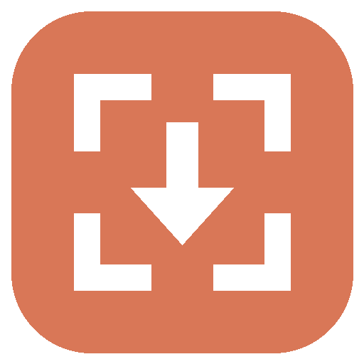
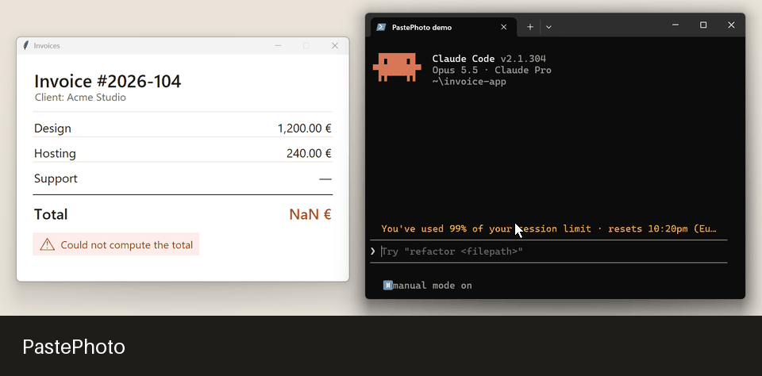

<p align="center">
  
</p>

<h1 align="center">PastePhoto</h1>

<p align="center">
  <b>Take a screenshot and it shows up in Claude by itself.</b>
</p>

<p align="center">
  <a href="https://github.com/igarbayo/paste-photo/releases/latest"></a>
  <a href="https://github.com/igarbayo/paste-photo/actions/workflows/ci.yml"></a>
  <a href="LICENSE"></a>
  
</p>

<!-- Badges: register the project first, then uncomment.
     REUSE:      https://api.reuse.software/register
     OpenSSF BP: https://www.bestpractices.dev/en/projects/new (copy the badge from your project page)
     Scorecard:  https://scorecard.dev/
[](https://api.reuse.software/info/github.com/igarbayo/paste-photo)
[](https://scorecard.dev/viewer/?uri=github.com/igarbayo/paste-photo)
-->

PastePhoto lives in the system tray. When you take a screenshot, it pastes the image into
the Claude you used last, without sending it, and puts you back where you were. It works on
**Windows, macOS and Linux**, in **any terminal** and in **Chromium-based browsers and
Firefox** (and, without the extension, in **Safari** and other browsers such as GNOME Web).
macOS support is new and experimental.

<p align="center">
  
</p>

## Features

- **Pastes into the Claude you are using**: Claude Code in a terminal, or any claude.ai chat
  (Chat, Code, Design) in the browser. If Claude is open in several places, the one you used
  last wins.
- **Never sends anything**: the image is attached to the prompt and you decide when to send.
- **Lands where your cursor is**: the image goes where you left the cursor in the prompt, even
  if you clicked elsewhere afterwards. If the cursor was never in that prompt, it goes at the
  end (browser extension; see [How it works](#how-it-works) for the other ways).
- **Each screenshot is pasted once**: if you remove it, it does not come back.
- **Browser extension** for Chrome, Edge, Brave, Vivaldi, Opera and **Firefox** (also
  LibreWolf): pastes into claude.ai without switching tabs, even into a background tab, on
  Windows, macOS, X11 and Wayland.
- **System tray icon** (menu bar on macOS): pause or resume, choose where to paste,
  notifications, and start when you sign in.
- **`paste-photo doctor`** tells you what will work on your computer and how to fix what won't.

## Supported platforms

| System | Where Claude runs | How it pastes | Status |
|---|---|---|---|
| Windows 10/11 (x64) | Claude Code in Windows Terminal (also inside WSL) | focuses the tab, Alt+V | ✅ |
| Windows 10/11 (x64) | Claude Code in an **Orca** terminal | Orca's CLI, no focus needed | ✅ |
| Windows 10/11 (x64) | claude.ai in Chrome, Edge, Brave, Vivaldi, Opera | browser extension, or focus + Ctrl+V | ✅ |
| Windows 10/11 (x64) | claude.ai in **Firefox** | browser extension, or focus + Ctrl+V | ✅ |
| Windows 10/11 (x64) | claude.ai in LibreWolf, Waterfox, Floorp, Zen | same as Firefox | ⚠️ Experimental |
| Linux (any) | Claude Code inside **tmux** | `tmux send-keys`, no focus needed | ✅ |
| Linux (any) | Claude Code in **kitty** (remote control on) or **WezTerm** | terminal's own CLI, no focus needed | ✅ |
| Linux (any) | Claude Code in **Konsole** | D-Bus, no focus needed | ✅ |
| Linux (any) | Claude Code in an **Orca** terminal | Orca's CLI, no focus needed | ✅ |
| Linux, X11 | Claude Code in **any other terminal** (GNOME Terminal, Ptyxis, xterm, Alacritty…) | focuses the window, Ctrl+V | ✅ |
| Linux, GNOME Wayland | Any other terminal | needs `paste-photo setup gnome` | ⚠️ Experimental |
| Linux, KDE Wayland | Any other terminal | KWin + permission prompt once | ⚠️ Experimental |
| Linux (any) | claude.ai in Chrome, Chromium, Edge, Brave, Vivaldi, Opera | browser extension | ✅ |
| Linux (any) | claude.ai in **Firefox** | browser extension | ✅ |
| Linux (any) | claude.ai in LibreWolf | browser extension | ⚠️ Experimental |
| Linux, X11 | claude.ai in **any browser without the extension** (GNOME Web, Falkon, qutebrowser…) | focuses the window, Ctrl+V; only if Claude's tab is the active one and the cursor is in the prompt | ✅ (tested with Firefox) |
| Linux, GNOME/KDE Wayland | claude.ai in any browser without the extension | same, through `setup gnome` / KWin | ⚠️ Experimental |
| macOS | Claude Code inside **tmux** | `tmux send-keys`, no focus needed | ✅ (tested on a real Mac in CI) |
| macOS | Claude Code in **iTerm2** | AppleScript, no focus needed, any tab | ⚠️ Experimental |
| macOS | Claude Code in **Terminal** | AppleScript selects the tab, Ctrl+V, back to your tab | ⚠️ Experimental |
| macOS | Claude Code in **kitty** (remote control on), **WezTerm** or **Orca** | terminal's own CLI, no focus needed | ⚠️ Experimental |
| macOS | Claude Code in **any other terminal** (Ghostty, Alacritty, Warp…) | focuses the window, Ctrl+V | ⚠️ Experimental |
| macOS | claude.ai in Chrome, Edge, Brave, Vivaldi, Chromium, Firefox | browser extension | ⚠️ Experimental |
| macOS | claude.ai in **Safari**, or Chrome, Edge, Brave, Vivaldi, Chromium without the extension | AppleScript selects the tab (also a background one), Cmd+V, back to your tab | ⚠️ Experimental |
| macOS | claude.ai in Firefox, Arc, Opera… without the extension | focuses the window, Cmd+V; only if Claude's tab is the active one | ⚠️ Experimental |

"Experimental" means it is implemented but has not been tested on a real desktop yet. Tell us
how it goes in an [issue](https://github.com/igarbayo/paste-photo/issues).

## Install

### Windows

**Installer (recommended).** Download `paste-photo-setup-X.Y.Z.exe` from
[Releases](https://github.com/igarbayo/paste-photo/releases) and run it. You can choose to
start PastePhoto with Windows and to add `paste-photo-cli` to your PATH.

> The installer is not code-signed yet, so Windows SmartScreen may say "Windows protected
> your PC". Click **More info → Run anyway**.

**winget.** The package is under review in the public winget catalog. Once accepted:

```powershell
winget install igarbayo.paste-photo
```

### Linux

**Debian, Ubuntu, Mint…** Download `paste-photo_X.Y.Z_all.deb` from
[Releases](https://github.com/igarbayo/paste-photo/releases):

```bash
sudo apt install ./paste-photo_X.Y.Z_all.deb
```

**Any distribution, with pipx.** You also need `xclip` (X11) or `wl-clipboard` (Wayland),
which Claude Code itself uses to read pasted images:

```bash
pipx install --system-site-packages git+https://github.com/igarbayo/paste-photo
```

`--system-site-packages` lets the tray use your system's AppIndicator support (`python3-gi`).

Then check your setup:

```bash
paste-photo doctor
```

### macOS (experimental)

There is no app bundle yet: install it with [pipx](https://pipx.pypa.io/) (`brew install
pipx`) and start it from a terminal. Its icon appears in the menu bar.

```bash
pipx install git+https://github.com/igarbayo/paste-photo
paste-photo doctor
paste-photo &
```

macOS asks for two permissions:

- **Accessibility** (System Settings → Privacy & Security → Accessibility), to bring a window
  to the front and press the paste key: Terminal, other terminals and browsers without the
  extension need it. Turn it on for the app you start PastePhoto from (for example Terminal)
  and, for **Iniciar al iniciar sesión** (start at login), for the Python program that
  `paste-photo doctor` shows. iTerm2, tmux, kitty, WezTerm, Orca and the browser extension
  work without it.
- **Automation**: the first time PastePhoto controls Terminal, iTerm2, Safari or Chrome,
  macOS asks whether to allow it. Say yes (you can change it later in System Settings →
  Privacy & Security → Automation).

Claude Code on macOS reads pasted images by itself; nothing else to install.

### Browser extension (optional, Windows, macOS and Linux)

The extension lets PastePhoto paste into claude.ai without switching tabs, and also into
background tabs. Run this once:

```bash
paste-photo setup browser        # paste-photo-cli setup browser on Windows
```

It registers PastePhoto with your browsers and prints where the extension is.

**Chrome, Edge, Brave, Vivaldi, Opera.** Open `chrome://extensions` (or `edge://extensions`,
`brave://extensions`…), turn on **Developer mode**, click **Load unpacked** and choose the
folder that `setup browser` printed.

**Firefox (and LibreWolf).** Install `paste-photo-firefox-X.Y.Z.xpi` from
[Releases](https://github.com/igarbayo/paste-photo/releases): open the file with Firefox, or
go to `about:addons` → ⚙ → **Install Add-on From File**. Regular Firefox only installs
add-ons signed by Mozilla; if the release's `.xpi` is not signed, it installs in Firefox ESR,
Developer Edition, Nightly and LibreWolf after setting `xpinstall.signatures.required` to
`false` in `about:config` (`setup browser` also writes the `.xpi` to your computer). Firefox
121 or later (128 or later recommended).

GNOME Web (Epiphany) and Safari can't use the extension: their extensions can't talk to
other apps the same way (no native messaging; Safari would need an app of its own).
PastePhoto uses their window or, in Safari, AppleScript instead (see the table above).

### GNOME on Wayland

GNOME doesn't let apps see other windows. If your terminal isn't tmux, kitty, WezTerm,
Konsole or Orca, install the small GNOME Shell helper and sign out and back in once:

```bash
paste-photo setup gnome
```

### From source

```bash
git clone https://github.com/igarbayo/paste-photo.git
cd paste-photo
python -m venv .venv
.venv/bin/pip install -e .         # .venv\Scripts\pip on Windows
.venv/bin/paste-photo
```

## Use

1. Start **PastePhoto** from your applications menu (on macOS, run `paste-photo` in a
   terminal). Its icon appears in the system tray (menu bar on macOS).
2. Open Claude: Claude Code in a terminal, or claude.ai in your browser.
3. Take a screenshot (**Win+Shift+S** on Windows, **PrtSc** or your usual tool on Linux). The
   image shows up in the Claude prompt (`[Image #1]` in the terminal). Add your message and
   send it whenever you want.

On macOS, **Cmd+Ctrl+Shift+4** (copy the screenshot) pastes it right away. **Cmd+Shift+4**
(save it to a file) works too: PastePhoto picks up the new file in your screenshots folder
(the Desktop by default) and copies it to the clipboard, but macOS only writes the file when
the floating thumbnail goes away, a few seconds later. To skip that wait, turn off **Show
Floating Thumbnail** in **Cmd+Shift+5 → Options**.

Right-click the tray icon (click it on macOS):

```text
 PastePhoto: activo
 ─────────────────────────────
 ✔ Activado                     pause / resume (the icon turns gray when paused)
   Pegar en ▸                   the Claude you used last | the order in the config
 ✔ Notificaciones
 ─────────────────────────────
   ¿Dónde pegaría ahora?        shows where the next screenshot would go
   Abrir configuración
   Ver registro
 ✔ Iniciar con Windows          ("Iniciar al iniciar sesión" on macOS and Linux)
 ─────────────────────────────
   Salir
```

### Command line

On Windows the installer includes `paste-photo-cli` for terminals; on macOS and Linux use
`paste-photo`.

```bash
paste-photo doctor          # what works on this computer, and how to fix the rest
paste-photo --probe         # where the next screenshot would go (pastes nothing)
paste-photo run --debug     # run in the terminal with detailed logs (Ctrl+C to stop)
paste-photo setup browser   # register the browser extension
paste-photo setup gnome     # GNOME Wayland helper (Linux)
paste-photo --list-targets  # supported places where Claude can run
```

Sample `--probe` output, with Claude open in tmux and in the browser:

```text
1. browser_extension  -> 'New chat - Claude'
2. tmux               -> 'tmux %3'
```

## Configuration

The settings file is created the first time you run PastePhoto, with every option
commented: `%APPDATA%\paste-photo\config.toml` on Windows,
`~/Library/Application Support/paste-photo/config.toml` on macOS and
`~/.config/paste-photo/config.toml` on Linux. Open it from the tray menu (**Abrir configuración**) and restart PastePhoto after
editing it. Changes made from the tray menu apply right away.

The most useful options:

- `prefer = "recent"`: paste into the Claude you used last. `"order"` follows the order of
  the `[[targets]]` list instead.
- `title_regex`: only paste into a specific terminal tab, e.g. `"my-project"`.
- `enabled = false` on a `[[targets]]` entry turns that place off.
- `browsers` on the `browser` (Windows), `linux_browser` and `macos_browser` targets: the
  browsers to look in, by process name. On macOS, `scriptable = false` on `macos_browser`
  stops using AppleScript (only the window title is used). A settings file created by an older version may not list Firefox: add
  `"firefox.exe"` to `browsers` of the `browser` target, or delete the file to recreate it.
- `cli` on the `orca` target: path to Orca's CLI if PastePhoto can't find it (it looks in
  your PATH and in Orca's install folder).

Logs: `%LOCALAPPDATA%\paste-photo\logs` on Windows, `~/Library/Logs/paste-photo` on macOS and
`~/.local/state/paste-photo/logs` on Linux (tray menu: **Ver registro**).

### kitty

To paste without switching windows, enable kitty's remote control in `kitty.conf`:

```text
allow_remote_control socket-only
listen_on unix:@kitty
```

On macOS use a socket file instead (`@kitty` only exists on Linux):
`listen_on unix:/tmp/kitty`.

Without it, kitty is handled like any other terminal (Claude's tab has to be the active one).

### Orca

[Orca](https://github.com/stablyai/orca) needs no setup: while Orca is open, PastePhoto uses
its CLI (`orca terminal send`) to press Claude Code's paste key in the exact terminal where
Claude runs, even if that terminal isn't the visible one.

## How it works

```text
 screenshot ──► clipboard / screenshot folder ──► orchestrator ──► most recently used Claude
                (new image only)                  (each image     ├─ browser extension (any tab; Chromium, Firefox)
                                                   pasted once)   ├─ tmux · kitty · WezTerm · Konsole · Orca · iTerm2
                                                                  │   (writes Ctrl+V into the pane)
                                                                  ├─ Terminal, Safari, Chrome on macOS:
                                                                  │   AppleScript picks the tab, then ↓
                                                                  └─ any terminal or browser window:
                                                                     focus + Ctrl+V (Alt+V in Windows
                                                                     terminals, Cmd+V in macOS
                                                                     browsers), focus back
```

In terminals PastePhoto only presses Claude Code's paste key, so Claude inserts
`[Image #N]` at its own cursor. In the browser, the extension pastes at the prompt's current
cursor, or the last one it had there, or at the end. Without the extension:

- **Windows** (Chromium and Firefox): PastePhoto focuses the prompt and the browser puts the
  cursor back where it was; if it was never there, the image goes at the start.
- **Linux**: PastePhoto only switches to the browser window and presses Ctrl+V, so the
  image goes in only if the cursor was in the prompt.
- **macOS**: in Safari and Chromium browsers AppleScript selects Claude's tab (even a
  background one), PastePhoto presses Cmd+V and goes back to the tab you had; in other
  browsers it works like on Linux. Either way the image goes in only if the cursor was in
  the prompt.

The core does not depend on the operating system. Each OS, each place Claude can run and each
user interface (tray, console) is a separate piece, so new ones can be added without touching
the core.

## Troubleshooting

| Problem | Fix |
|---|---|
| Nothing gets pasted | Run `paste-photo doctor`. Check that the tray icon is there and not gray (paused). |
| I can't see the tray icon | Windows 11: look in the hidden area (`^`). GNOME: install the "AppIndicator and KStatusNotifierItem Support" extension. macOS: it's in the menu bar; with many icons it can hide behind the notch. |
| "PastePhoto ya se está ejecutando" (already running) | Only one instance runs at a time. Use the one in the tray, or quit it first. |
| It pastes in the wrong place | Click into the Claude you want before taking the screenshot, or set `prefer = "order"`. |
| The browser extension doesn't connect | Run `paste-photo setup browser` again and reload the extension. Browsers installed as a **snap** or **Flatpak** restrict this; use the .deb/.rpm build of your browser. |
| Linux, no extension: nothing appears in claude.ai | Claude's tab must be the active one in its window and the cursor must be in the prompt. Or install the extension. |
| Firefox says the add-on "could not be verified" | The `.xpi` is not signed by Mozilla. Use a signed release, or Firefox ESR / Developer Edition / Nightly / LibreWolf with `xpinstall.signatures.required = false`. |
| The image goes to the start of the claude.ai prompt | Without the browser extension PastePhoto can't know whether you ever put the cursor there. Install the extension, or click in the prompt once. |
| Orca: nothing gets pasted | Orca has to be open. Run `paste-photo doctor`; if it can't find Orca's CLI, set `cli` on the `orca` target. |
| Linux: nothing happens in GNOME Terminal on Wayland | Run `paste-photo setup gnome` and sign out and in, or use tmux. |
| Linux: the image never reaches Claude Code | Install `xclip` (X11) or `wl-clipboard` (Wayland); Claude Code needs it to read images. |
| macOS: nothing gets pasted in Terminal, Ghostty or the browser | Give PastePhoto the **Accessibility** permission (see [macOS](#macos-experimental)) and run `paste-photo doctor`. iTerm2, tmux and the browser extension don't need it. |
| macOS: "not allowed to send Apple events" in the log | You declined the **Automation** prompt: allow it in System Settings → Privacy & Security → Automation. |
| macOS: a Cmd+Shift+4 screenshot takes a few seconds to appear | macOS writes the file when the floating thumbnail goes away. Use Cmd+Ctrl+Shift+4, or turn off the thumbnail in Cmd+Shift+5 → Options. |
| "Windows protected your PC" | The installer is not code-signed yet: **More info → Run anyway**. |

## Uninstall

- **Windows**: **Settings → Apps → Installed apps → PastePhoto → Uninstall**. This removes the
  start with Windows entry and the PATH entry.
- **macOS**: `pipx uninstall paste-photo`. Turn off "Iniciar al iniciar sesión" first, or
  delete `~/Library/LaunchAgents/io.github.igarbayo.paste-photo.plist`.
- **Linux**: `sudo apt remove paste-photo` or `pipx uninstall paste-photo`. Turn off "Iniciar al
  iniciar sesión" first, or delete `~/.config/autostart/paste-photo.desktop`.

Your settings are kept in all cases.

## License

PastePhoto is released under the [MIT License](LICENSE). It is provided **without any
warranty**. The installers bundle third-party components under their own licenses (MIT, BSD,
Apache-2.0, PSF and LGPL-3.0 for pystray). Their notices ship with the app. See
[docs/COMPONENTS_LICENSE.md](docs/COMPONENTS_LICENSE.md) for the full analysis.

PastePhoto is an independent project, not affiliated with or endorsed by Anthropic.
"Claude" is a trademark of Anthropic and is only used here to describe what PastePhoto
works with.

## Support

Open an [issue](https://github.com/igarbayo/paste-photo/issues). Contributions are welcome:
see [CONTRIBUTING.md](CONTRIBUTING.md). Changes are listed in [CHANGELOG.md](CHANGELOG.md).
